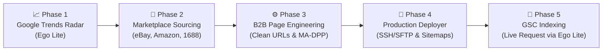

# 🚀 B2B Category Trend Launch Engine

[](LICENSE)
[](references/clean_urls_standard.md)
[](https://github.com/ego-browser)
[](https://trends.google.com)
[](https://search.google.com/search-console)

> **All-in-One Autonomous B2B Sourcing & Export Launch Engine**: Discover high-growth viral trends on Google Trends, reverse-engineer top marketplace listings, generate clean-URL responsive landing pages, deploy across multi-server production clusters, and request immediate indexing in Google Search Console (GSC).

---

## 🌟 Why This Exists (The Problem)

Traditional B2B cross-border e-commerce and factory exports suffer from:
1. **Lagging Market Awareness**: Discovering viral products months after domestic US/EU retail breakouts.
2. **Manual Product Listing Bottlenecks**: Designing landing pages, sourcing imagery, calculating tiered wholesale quotes, and creating XML sitemaps by hand.
3. **SEO Flaws & Indexing Delays**: Exposing clumsy `.html` static extensions, broken canonicals, or waiting weeks for Google spiders to crawl new URLs.

**B2B Category Trend Launch Engine** solves this by automating the entire lifecycle from trend discovery to Google indexing in **under 15 minutes**.

---

## 🏗️ Architecture & 5-Phase Universal Workflow



---

## 📦 Supported Category DNA Profiles

The engine includes pre-calibrated industry configurations in `templates/category_profiles.json`:

| Category Key | Industry Focus | Key Certifications | Typical Materials | MOQ Norms |
|---|---|---|---|---|
| **`toys`** | Sensory, Squeeze, RC Robotics, Blind Box, Bag Charms | ASTM F963-23, EN71-1/2/3, CPSIA, CPC, BSCI | Food-Grade ABS, Non-toxic PP, PU, TPR | 1,000 pcs (Stock: 100) |
| **`shoes`** | Safety Boots, Barefoot Shoes, Cork Clogs, Workwear | ASTM F2413, EN ISO 20345, CE, LWG | Full-Grain Leather, Kevlar, Steel Toe | 500 pairs |
| **`garments`** | Seamless Activewear, Jackets, Sports Uniforms | OEKO-TEX 100, GOTS, WRAP, BSCI | Nylon + Spandex, Recycled Polyester | 300 pcs / color |
| **`lunch box`** | Heated Bento, Insulated Courier Bags, Steel Bento | FDA 21 CFR, LFGB, BPA-Free, CE, RoHS | SUS 304/316 Steel, Virgin PP, Silicone | 500 pcs |
| **`stone machine`**| 5-Axis CNC Bridge Saw, Edge Polishers, Wire Saws | CE Machinery Directive 2006/42/EC, ISO 9001 | Heavy-Duty Cast Iron, Hiwin Rails | 1 set |
| **`hygiene`** | Baby Diapers, Incontinence Pants, Sanitary Napkins | FDA 510(k), CE MDR, ISO 13485, Dermatest | Sumitomo SAP, Fluff Pulp, Breathable PE | 1x40HQ Container |
| **`bathware`** | Brass Ball Valves, Stainless Faucets, Shower Systems | cUPC, WaterSense, CE EN 817, WRAS | DZR Brass (HPb59-1), SUS 304 | 200 pcs |

---

## 🚀 Quickstart & Usage

### 1. Phase 1: Scan Category Trends (Google Trends via Ego Lite)
```bash
ego-browser nodejs scripts/trend_radar.js \
  --category "toys" \
  --geo "US" \
  --time "now 7-d" \
  --output "trends_report.json"
```

### 2. Phase 2: Scrape Benchmark Listing & Extract High-Res Assets
```bash
ego-browser nodejs scripts/marketplace_scraper.js \
  --query "collectible bag charm toys" \
  --outDir "./scraped_product"
```

### 3. Phase 3: Generate Clean URL Landing Pages
```bash
python3 scripts/page_generator.py \
  --productJson "./scraped_product/product_data.json" \
  --siteConfig "./site_configs/wishtimetoys.json" \
  --category "toys" \
  --outDir "./dist"
```

### 4. Phase 4: Deploy to Remote Production Servers
```bash
python3 scripts/fast_deployer.py --config "deploy_config.json"
```

### 5. Phase 5: Request Indexing in Google Search Console
```bash
ego-browser nodejs scripts/gsc_indexer.js \
  --resourceId "sc-domain:wishtimetoys.com" \
  --url "https://example.com/products/collectible-figures-bag-charms" \
  --sitemap "sitemap-products.xml"
```

---

## 🌐 The Zero `.html` Policy (Clean URLs Standard)

Every generated asset strictly adheres to clean URL routing:
- **Canonical URLs**: `https://example.com/products/product-slug`
- **OpenGraph & Twitter**: `https://example.com/products/product-slug`
- **Internal Links**: `<a href="/products/product-slug">` (Never `href="...html"`)
- **XML Sitemaps**: `<loc>https://example.com/products/product-slug</loc>`

### Audit Your Build
```bash
python3 scripts/clean_url_auditor.py --dir "./dist"
```

---

## 🧪 Testing Suite
Run automated unit and integration tests:
```bash
python3 tests/test_pipeline.py
```

---

## 📄 License
Released under the [MIT License](LICENSE). Built for high-velocity global B2B export manufacturers.
