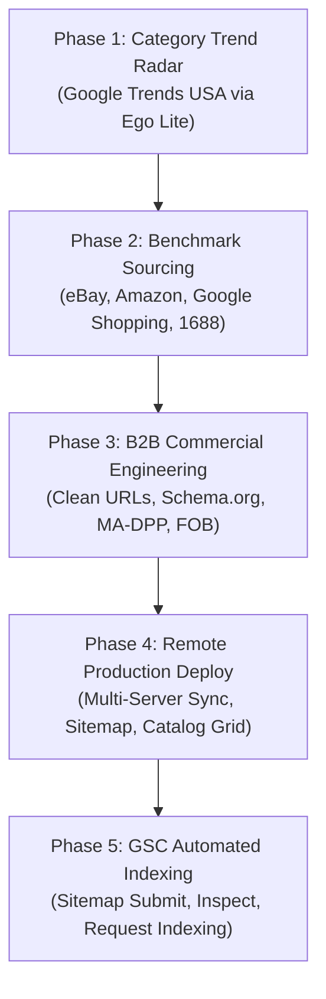

# B2B Category Trend Launch Engine
### 跨品类出海爆款雷达 · 多源逆向工程 · 伪静态建站 · 自动化部署 · GSC 极速索引总控技能

## 🎯 技能概述 (Overview)

本技能提供从**全球市场趋势发现**到**多独立站批量发布**与**搜索引擎索引收录**的端到端全闭环工作流：
1. **Google Trends 趋势穿透**：通过 Ego Lite 自动化挖掘目标品类过去 7/30 天的飙升搜索词（Breakout Queries +100%~+500%）。
2. **多源正品电商逆向**：穿透 Google Shopping、eBay、Amazon 及 1688，逆向提取 1:1 高清画册、产品构成及技术规格。
3. **B2B 商业包装与落地页生成**：严格遵循 **Global Clean URLs Standard (Zero `.html` Policy)**，生成内嵌 Schema.org 知识图谱、MA-DPP 数字产品护照及阶梯批发报价的高转化响应式页面。
4. **多服务器生产级部署**：通过 Paramiko SSH/SFTP 执行毫秒级多站热插拔发布，同步注入产品目录网格并增量更新 XML 网站地图。
5. **Google Search Console 极速收录**：调用 Ego Lite 自动化提交 Sitemap，通过顶部检查栏触发 live URL 测试并一键点击 **`REQUEST INDEXING`**。

---

## 🏗️ 核心架构与五大阶段 (The 5-Phase Workflow)



---

## 🛠️ Phase 1: 趋势雷达检索 (Category Trend Radar)

通过 Ego Lite 打开 Google Trends（支持美、英、德、欧、东南亚等区域）：
```bash
ego-browser nodejs scripts/trend_radar.js \
  --category "toys" \
  --geo "US" \
  --time "now 7-d" \
  --output "trends_report.json"
```

### 支持的核心品类预设 (`templates/category_profiles.json`)：
- **`toys`**：益智玩具、减压捏捏乐、盲盒潮玩、快餐促销挂件、RC 机器人。
- **`shoes`**：劳保鞋、赤足鞋、软木勃肯鞋、运动球鞋、摔跤鞋。
- **`garments`**：无缝瑜伽服、冲锋衣、工装制服、羽绒服、运动压缩衣。
- **`lunch box`**：加热饭盒、不锈钢便当盒、医用冷链野餐包、硅胶折叠碗。
- **`stone machine`**：五轴 CNC 桥切机、红外切机、石材自动磨边机、矿山绳锯机。
- **`hygiene`**：婴儿纸尿裤、成人失禁裤、卫生巾、无纺布卷材。
- **`bathware`**：黄铜球阀、恒温淋浴花洒、不锈钢水龙头、卫浴台盆。

---

## 🔍 Phase 2: 标杆提单逆向工程 (Benchmark Sourcing)

定位到爆款词后，调用脚本自动搜索 Google Shopping / eBay / Amazon：
```bash
ego-browser nodejs scripts/marketplace_scraper.js \
  --query "collectible bag charm toys" \
  --outDir "./scraped_product"
```
- **高清原图获取**：自动将 eBay 图片后缀 `s-l500.` / `s-l300.` 升级为 `s-l1600.`；将 Amazon 图片升级为 `._AC_SL1500.`。
- **规格参数拆解**：提取材质构成、套装件数、执行标准、官方配件（如集换卡牌、背包挂扣）。

---

## 💻 Phase 3: B2B 落地页生成 (Zero `.html` Policy)

运行通用生成器，融合企业 DNA 与品类出海合规资质：
```bash
python3 scripts/page_generator.py \
  --productJson "./scraped_product/product_data.json" \
  --siteConfig "./site_configs/wishtimetoys.json" \
  --category "toys" \
  --outDir "./dist"
```

### 强制合规约束：
- **无 `.html` 后缀规范**：
  - Canonical: `<link rel="canonical" href="https://example.com/products/slug">`
  - OpenGraph: `<meta property="og:url" content="https://example.com/products/slug">`
  - Internal Links: `href="/products/slug"`（严禁出现 `.html`）
- **MA-DPP 数字产品护照**：输出欧盟 ESPR 2026/2027 规范的追溯代码 `MA.156.100015.01.{SKU}`。
- **结构化微数据**：内嵌完整的 `Organization`、`BreadcrumbList`、`Product` 与 `AggregateOffer`。

---

## 🚀 Phase 4: 多服务器自动化部署 (Remote Fast Deployer)

配置 `deploy_config.json` 并调用快速部署脚本：
```bash
python3 scripts/fast_deployer.py --config "deploy_config.json"
```
1. 自动上传 WebP/JPG 优化图片至 `/var/www/{domain}/images/products/`。
2. 部署无后缀 HTML 文件至 `/products/{slug}.html` 及根目录别名 `/{slug}.html`。
3. 远程就地执行 Python 脚本，将产品卡片插至 `products.html` 顶部，并在 `sitemap.xml` 中注入新 URL。
4. 修复文件属主与权限（`www-data:www-data` 或 `ubuntu:ubuntu`）。
5. 自动验证 live HTTP 状态码，确保全量返回 **`200 OK`**。

---

## 📡 Phase 5: Google Search Console 提交与索引起飞

通过 Ego Lite 操控 Google Search Console：
```bash
ego-browser nodejs scripts/gsc_indexer.js \
  --resourceId "sc-domain:wishtimetoys.com" \
  --url "https://example.com/products/collectible-figures-bag-charms" \
  --sitemap "sitemap-products.xml"
```
- **Sitemap 提交**：自动填入 `sitemap-products.xml` 并点击 Submit。
- **顶部检查栏直达**：输入全新 Clean URL 回车。
- **极速收录申请**：识别并点击 **`REQUEST INDEXING`**，捕获存证截图。

---

## 🛡️ 质量审计闸门 (Quality Gate)

在交付任何页面前，必须运行无后缀路由扫描审计器：
```bash
python3 scripts/clean_url_auditor.py --dir "./dist"
```
一旦检测到任何内链、Canonical 或 Sitemap 存在 `.html` 扩展名，直接阻断交付。
